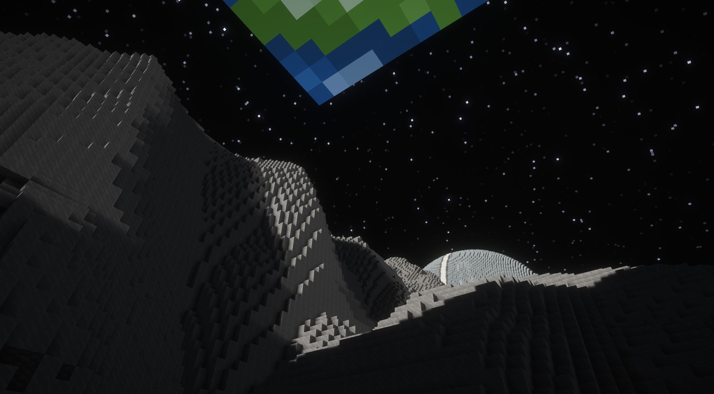

### Changes

- Updated to Complementary Shaders r5.10 [YOUTUBE SHOWCASE](https://www.youtube.com/watch?v=p7rlihjYQ1Q)
- This update adds new space dimensions! Significantly improving the look of Ad Astra and Stellaris!
- It also adds a cave/void dimension for such dimensions
- Twilight Forest also looks incredible now. Requires the Euphoria Patcher mod jar
- Added modded fog support. This includes modded fog from Alex's Caves but also Atmospherics
- Added LabPBR SSS under the improved LabPBR option. This now fully completes LabPBR support on Complementary as far as I know, with the Improved LabPBR option
- Added skylight SSS option (forced enabled under LabPBR SSS)
- The skylight SSS also works with voxelization if you have ACT enabled
- Skylight SSS also works with lightning bolts if epic thunderstorm is enabled
- Added Blocklight SSS if ACT is enabled. ACT's voxelized blocklight makes SSS work on blocks
- Added honeycomb block ipbr SSS
- Added POM Rain Puddles!
- Massively improved performance when using varying aurora presets on Windows AMD. Other GPUs probably won't see a big difference
- Improved pixelated unbound cloud performance slightly and improved their visuals
- Make lightmap normals work with ACT-only light sources
- More improvements to Lightmap Normals thanks to plazmal
- Further improved modded support by making block entities support item/terrain materials as a fallback
- Added support to modded biome custom light levels thanks to my new euphoriaPatchesIsCurrentBiomeModded uniform. Requires the Euphoria Patcher mod jar
- Shockwave option works now with the Mace when the EP mod installed! Requires the Euphoria Patcher mod jar
- Shockwave sneak functionality is now toggled off by default (can be re-enabled), except for when the mace shockwave is not available
- Make situational glowing ores work with ACT
- Disable shader clouds in dimensions where they disable clouds. At least does the best attempt at it. Requires the Euphoria Patcher mod jar
- Improve performance by disabling a composite pass when it's not needed
- Added an error message on 1.7.10 to use angelica instead of optifine
- Added Automatic modded colored entity IDs
- Removed the blue screen option as it got annoying to maintain and no one used it
- Added a Use Synced Time setting, which when disabled, uses the frame counter to do animation instead of the synced time (useful in Hypixel where time glitches often)
- Added cloud sunset/sunrise shading settings
- Improve blood moon visibility with some resource packs
- Added euphoria patches realtime settings for Iris 1.12+
- Made cloud render distance affect vanilla clouds, only to lessen it. I can't create geometry out of thin air
- Added more modded content to the [properties files](https://github.com/EuphoriaPatches/propertiesFiles) thanks to the contributors <3
- Updated [translations](https://www.euphoriapatches.com/lang) thanks to the contributors <3

### Fixes

- Fix z-fighting with EP seasons snow and redstone dust
- Fixed spikes in the sky appearing with the atmospherics mod
- Fixed Sky resourcepack Support being broken with Nuit
- Fixed yellow poplar leaf particles being emissive
- Fix better labpbr refraction being incorrect with translucent entities in front of the block which refracts
- Fixed a bug where vanilla stars can flicker in sometimes on broken iris/oculus versions
- Fix that stupid end crystal flicker which happens sometimes, thanks to [@Eclipse](https://github.com/Eclipse-Sol)
- Prevent z-fighting on modded opaque stuff in gbuffers lightning
- Fixed enchanted armor with trims z-fighting on Iris Vulkan on some GPUs
- Fixed Mielon's The Sift mod doing some horrible hardcoded injections and breaking the shader, I now do my declaration above the block it would inject into...
- Fixed modded spidereyes z-fighting

