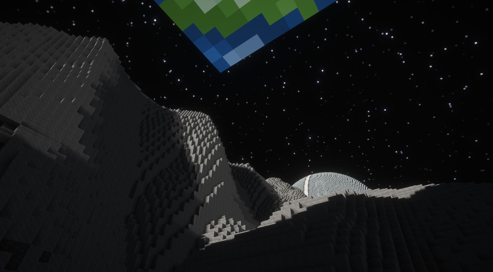

#### Please look at the 1.11.0 changes, this is just a small bugfix update.

### Changes

- Check out the main 1.11.0 [YOUTUBE SHOWCASE](https://www.youtube.com/watch?v=xu8--_-_qhQ)
- Added new reflection settings
- Significantly improved how gamerule advance time is handled for continuous animation, fixing cloud flicker with mods and sudden jumps in vanilla.

### Fixes

- Fixed compile errors on Mesa
- Fix smooth world animations at high world day count causing big stutters in clouds

